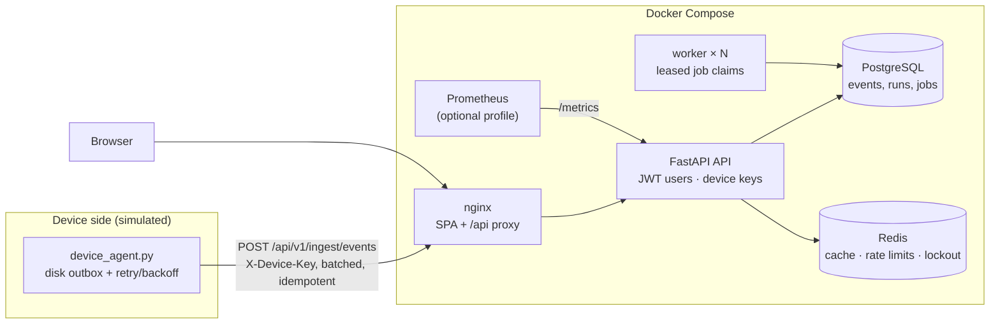
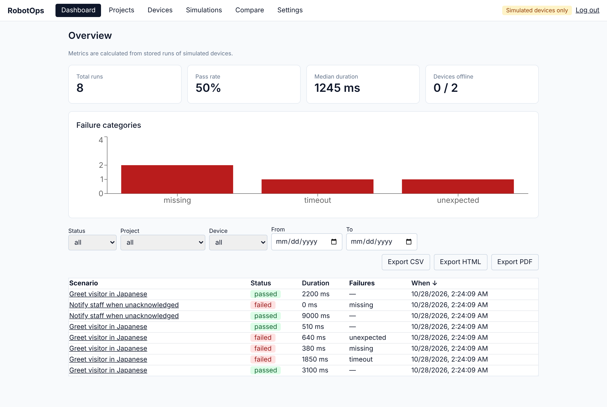
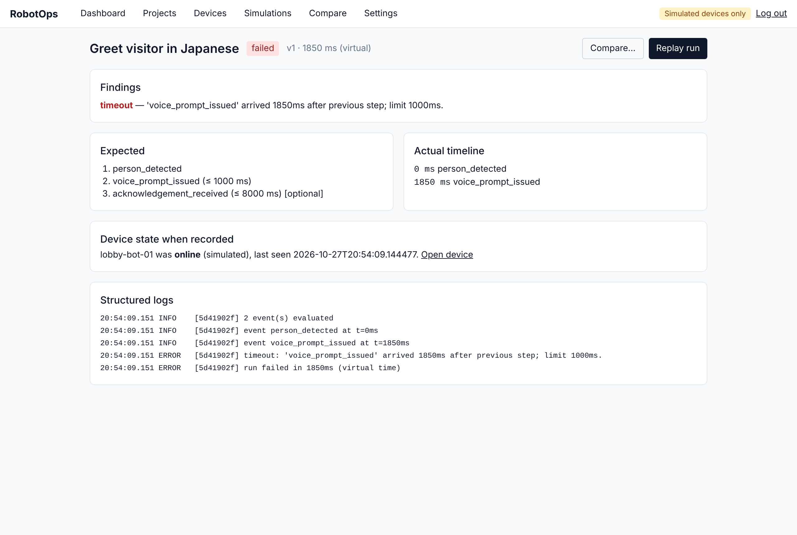
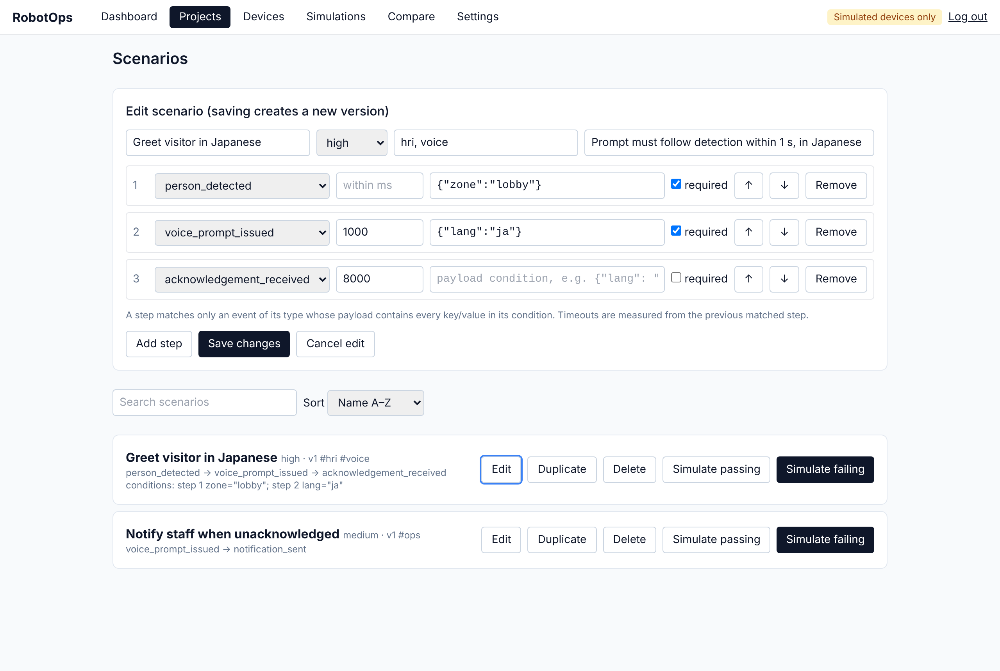
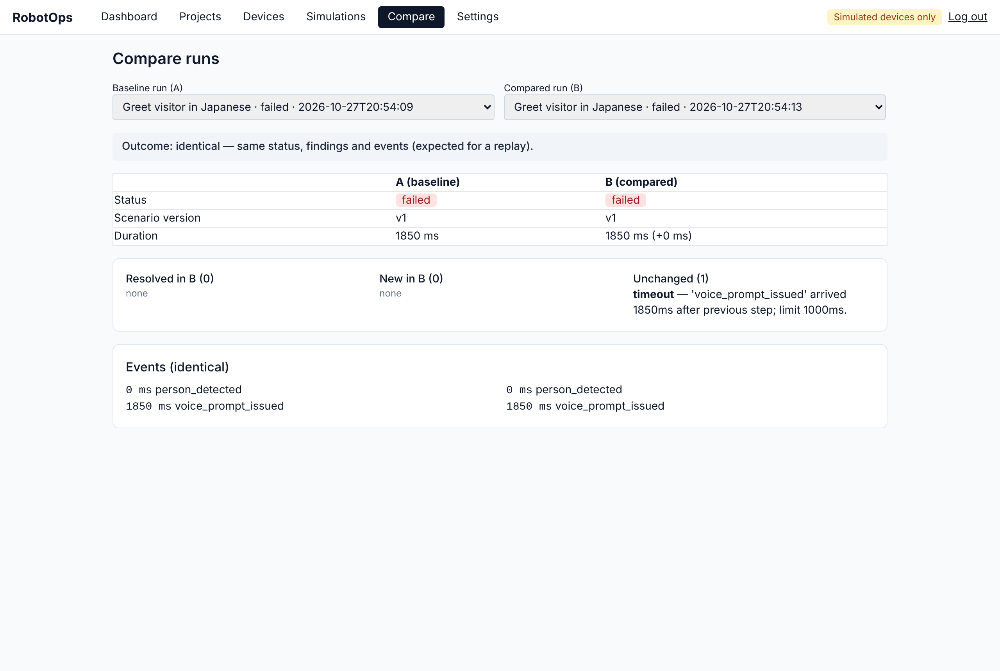
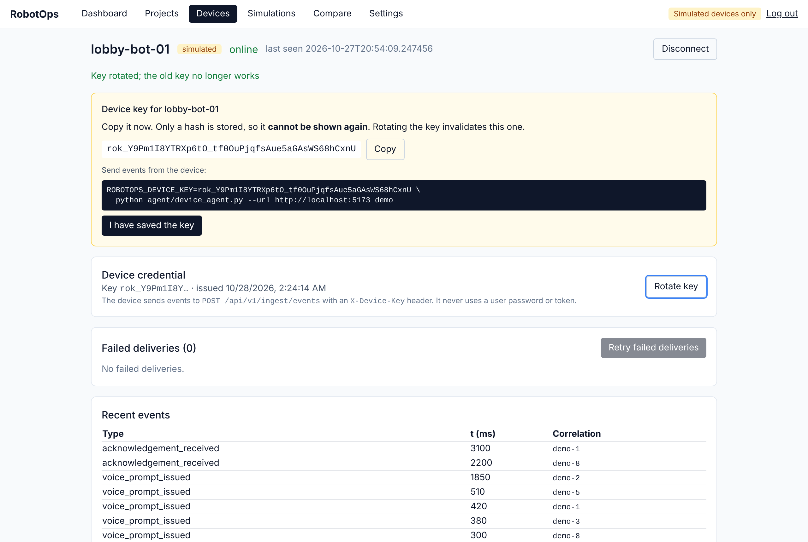

# RobotOps

A platform for defining, running, replaying and debugging validation scenarios for robots and the
device-to-cloud path behind them. A scenario such as *"when a person is detected, a Japanese voice prompt
must follow within 1000 ms"* is checked against the events a device actually sent, with findings
explained in plain language.

**All devices are simulated.** There is no ROS 2 or hardware integration; the device side is a
simulator plus a small stdlib-only agent (`agent/device_agent.py`) that speaks the real ingestion API.


**Stack:** FastAPI · SQLAlchemy 2 · Alembic · PostgreSQL 16 · Redis 7 · React + TypeScript (strict) ·
Vite · Tailwind · Docker Compose · nginx · Prometheus · GitHub Actions



## What it does

- **Scenarios** with ordered steps, per-step timeouts, required/optional steps and **payload conditions**
  (`{"lang": "ja"}`), versioned on every edit. Projects can be created, renamed and deleted.
- **Deterministic engine** (`backend/app/engine.py`): a pure function over virtual timestamps, so no
  clocks and no sleeps. Detects missing, out-of-order, unexpected and late events.
- **Runs, replay and compare:** each run stores the scenario snapshot, the events, the device state and a
  structured log. Replay re-evaluates the recorded events against the original scenario version, and
  compare diffs two runs (findings resolved/new/unchanged, event sequences).
- **Device-to-cloud ingestion:** every device gets its own API key (only a SHA-256 hash is stored, the key
  is shown once, and rotation invalidates the old key immediately). Ingestion is batched, idempotent per
  `event_id` (safe under concurrent retries), rate-limited per device, and separate from user auth.
- **Device agent:** writes each event to an fsync'd on-disk outbox *before* sending, then flushes with
  exponential backoff and jitter. A network outage loses nothing, a resend is reported as duplicates,
  and a rotated key stops the agent instead of retrying forever.
- **Background workers** run as their own containers and scale with `--scale worker=N`. A job is claimed
  with a conditional UPDATE and held by a lease (token plus heartbeat). Jobs of a crashed worker are
  recovered after the lease expires, and a worker that lost its lease stops before it can complete the job twice. Each worker has its own healthcheck: the job loop touches a heartbeat file, and a frozen worker turns unhealthy within about 2 minutes (verified by SIGSTOPping one).
- **Operations:** liveness (`/healthz`) and readiness (`/readyz`: DB required, Redis degraded-but-ready)
  endpoints. Prometheus `/metrics` labels routes by template, so cardinality stays bounded, and can be
  token-protected. It also reports queue age and device counts. Four alert rules ship with it. Other
  pieces: JSON logs with request IDs, an audit log, login lockout, request-size limit, uniform error
  bodies, CSV/HTML/PDF reports (with spreadsheet formula injection neutralised), and paginated, sortable
  list APIs (`X-Total-Count`).
- **Auth:** bcrypt passwords and short-lived JWTs (`exp` required, 60 min by default). Expired sessions
  return the user to sign-in with a message. Every record is owned by a user and checked server-side,
  and other users' objects return 404 so their existence doesn't leak.

## Screenshots

| Dashboard: metrics, failure categories, sortable and paginated runs | Run detail: finding, expected vs. actual, device state, logs |
|---|---|
|  |  |
| **Scenario editor: timeouts, optional steps, payload conditions** | **Replay compared with the original: identical outcome** |
|  |  |
| **Device credential: key shown once, rotation, agent command** | |
|  | |

_The key in the screenshot belongs to a throwaway local demo database._

## Run it

```bash
cp .env.example .env            # then set JWT_SECRET and POSTGRES_PASSWORD (openssl rand -hex 32)
docker compose up -d --build --scale worker=3
open http://localhost:8080      # register, then follow the demo below

docker compose --profile monitoring up -d   # adds Prometheus on 127.0.0.1:9090
```

Local development without Docker:

```bash
cd backend && pip install -r requirements.txt && uvicorn app.main:app --reload   # dev mode: SQLite, in-process worker
cd frontend && npm install && npm run dev                                        # proxies /api to :8000
```

Send events like a real device would (`device_key` is shown once when you register a device):

```bash
export ROBOTOPS_DEVICE_KEY=rok_...
python agent/device_agent.py --url http://localhost:8080 demo              # passes
python agent/device_agent.py --url http://localhost:8080 demo --slow 3000  # voice prompt 3 s late -> timeout
```

## Demo (5 minutes)

1. Register, create a project and a scenario: `person_detected` → `voice_prompt_issued` within 1000 ms
   with payload condition `{"lang": "ja"}`.
2. Register a device. Copy its key (it is shown once), then run the agent with `demo --slow 3000`.
3. On **Simulations**, queue a passing and a failing simulation. The worker containers run them.
4. Open the failing run: the timeout finding, expected vs. actual events, device state and structured logs.
   **Replay** it, then **Compare with original**, which reports the outcome as identical.
5. Rotate the device key, and show that the agent with the old key now stops with a 401.
6. Dashboard: filter, sort, page through and export the PDF. Optionally open Prometheus and query
   `robotops_device_events_total`.

## Verified

Everything here was run, not just written. "Real" means the actual services, not mocks.

| Check | Result |
|---|---|
| Backend tests | **59 pytest tests** pass on real PostgreSQL 16 + Redis 7, and all but the two PostgreSQL-only race tests on SQLite. Those two race 8 threads on the same event and on the same batch: each event is stored exactly once, with no errors |
| Agent tests | 6 unit tests (outbox persistence, retry, give-up-but-keep, duplicates, partial rejection backs off, rejected key is fatal) |
| Frontend | `tsc` strict build clean, 13 vitest tests |
| Browser E2E | 2 Playwright specs (critical workflow; device-to-cloud with key rotation, payload conditions, rename, session expiry) pass against dev servers **and through nginx against the Compose stack** |
| Containers | Both Dockerfiles build. The full stack (API, 3 workers, nginx, Postgres, Redis, Prometheus) comes up healthy with `docker compose up --wait`. The API runs as UID 10001 |
| Workers | 24 jobs on 3 worker containers: each completed exactly once, 24 runs. **Two workers were SIGKILLed mid-job**: the survivor recovered both jobs after the lease expired, giving 27/27 runs and no duplicates |
| Device-to-cloud | Agent against the live stack: buffered 2 events during an outage, delivered them when the network returned, the resend came back as duplicates, a bad key exited with code 2 and nothing was lost |
| Persistence | `docker compose down` then `up`: users, runs and events were all intact |
| Monitoring | `promtool` validates the config and 4 alert rules. The API target is `up`, and the metrics match the database |
| Migrations | 4 Alembic revisions: upgrade, `alembic check` (no drift), downgrade to base, upgrade again, all on PostgreSQL |
| Linters | ruff (lint and format check), hadolint (both Dockerfiles), actionlint, `docker compose config` |

Bugs found and fixed during this verification:
- Batch ingestion did a duplicate-check query and a commit for every event. It now does one `INSERT ... ON CONFLICT DO NOTHING RETURNING` per batch, which is **about 4.5× the throughput** (see Performance).
- nginx cached the API container's IP at startup, so redeploying the API caused 502s until nginx restarted. It now re-resolves through Docker DNS; verified by forcing a new API IP with nginx left running.
- With more than one worker, startup recovery re-queued *every* running job, stealing live work. It now
  uses leases and fencing.
- Two concurrent retries of the same event hit the unique constraint and returned a 500. They are now
  reported as duplicates.
- Passing simulations ignored payload conditions, so they failed. The generated events now satisfy them.
- JWTs never expired.
- Earlier: a worker race (job completed before its run existed), a PDF column overflow, steps numbered
  from 0, and a junk `CORS_ORIGINS` value.

## Performance

Device ingestion (`POST /api/v1/ingest/events`, batches of 50 events, each request authenticated with a device key) through the full Docker Compose stack (nginx → API → PostgreSQL 16 + Redis). Load comes from `scripts/load_ingest.py`, running on the same machine as the stack.

**Step 1: fix the write path** (2-vCPU / 7.8 GB cloud VM, Intel Xeon @ 2.1 GHz, 1 API process)

| Load | Before (per-event commit) | After (set-based insert) |
|---|---|---|
| 16 devices, 8 senders | 538 events/s, p95 842 ms | **2,461 events/s, p95 243 ms** |
| 64 devices, 32 senders (over capacity) | 513 events/s, p95 5.8 s | **2,198 events/s, p95 955 ms** |

**Step 2: find the next limit.** A 12-thread Windows laptop (Docker Desktop) gave about the same result with 1 API process: **2,247 events/s, p95 258 ms** (16 devices, 8 senders). Under load the API process used about 92% of one core while PostgreSQL used about 17%. So the limit was the single Python process, not the hardware.

**Step 3: run several API processes** (`WEB_CONCURRENCY`, default 4). Prometheus metrics are merged across processes. On the same 2-vCPU VM:

| Load | 1 API process | 4 API processes |
|---|---|---|
| 16 devices, 8 senders | 2,461 events/s, p95 243 ms | **3,980 events/s, p95 191 ms** |
| 64 devices, 32 senders | 2,198 events/s, p95 955 ms | **3,462 events/s, p95 838 ms** |

Every run: all events accepted, 0 duplicates, 0 errors (up to 133,050 events per run). The 32-sender rows are over capacity, so their latency is mostly queueing.

## Not verified

- The GitHub Actions workflow has not run on GitHub yet. Every job's commands, including the new
  `compose` job, were run locally.
- No public deployment: TLS, a domain and a cloud host are untested (see `docs/DEPLOYMENT.md`).
- Load was measured with the load generator on the same machine as the stack (see Performance). Not measured: a separate load-generator host, multiple API containers, sustained soak tests, and worker throughput.

## Known limits

- The JWT is kept in browser localStorage, which is exposed to XSS (an httpOnly cookie would be stronger).
  There is no refresh token or revocation list, no password reset and no email verification.
- Isolation is per user. There are no shared organisations or workspaces yet.
- Run creation and job completion are two writes. If a worker loses its lease in exactly that window, a
  job could in theory record one extra run (the event inserts themselves are always idempotent).
- The dashboard's "devices offline" figure is the current state, not the state at a past time.
- Seed data (`python -m app.seed`) is run by hand and flagged as demo data in all reports.

## Layout

```
backend/app/       main.py (API) · engine.py (pure evaluator) · worker.py + worker_main.py · obs.py (metrics) · db.py
backend/alembic/   migrations
backend/tests/     pytest (API, engine, worker, hardening, ops)
agent/             device_agent.py (stdlib only) + tests
frontend/src/      React pages, api client, shared components; e2e/ Playwright specs
docs/media/        README screenshots and demo GIF
monitoring/        Prometheus config + alert rules
scripts/           worker_chaos.py (multi-worker + crash check)
docs/              DEPLOYMENT.md
```
